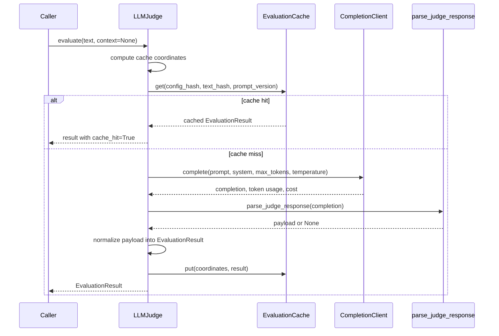
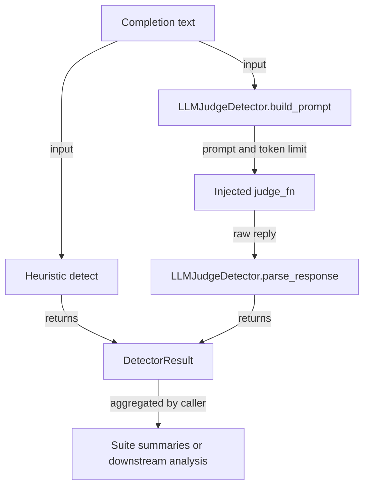
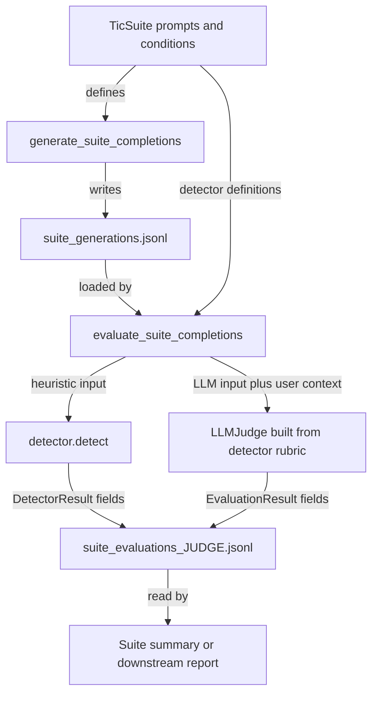
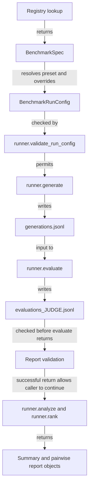

# Compass Architecture

Compass provides shared evaluation definitions, clients, scoring, persistence,
and analysis. Downstream experiment harnesses import Compass; Compass has no
runtime dependency on those harnesses.

## Module responsibilities

This table describes responsibilities, not an import-order graph.

| Module | Responsibility |
| --- | --- |
| `compass.rubrics` | Immutable rubric definitions, versions, and content hashes |
| `compass.clients` | Provider adapters, request policies, usage and pricing |
| `compass.judges` | `LLMJudge`, result/config types, parsing, reliability auditing |
| `compass.cache` | Persistent evaluation cache |
| `compass.detectors` | `TicSuite`, heuristic and direct LLM detectors, built-in suites |
| `compass.evaluation` | Checkpoint schemas, suite generation and scoring, saved-record loading |
| `compass.comparison` | Multi-judge comparison and pairwise ranking |
| `compass.benchmark` | `BenchmarkSpec`, registry, run policies, execution, reporting, validation |
| `compass.reproducibility` | Metadata and cost/report helpers |

The library exposes three scoring/execution interfaces: cached `LLMJudge`,
direct detectors, and runners that orchestrate those primitives. They do not
all follow the same call path.

## Cached judge request

The sequence shows calls and returned values for `LLMJudge.evaluate`.

The configuration hash includes the rubric hash, judge model, maximum tokens,
temperature, and seed. The text hash includes optional user context, and the
prompt-template version is a separate coordinate. `JudgeConfig.seed` affects
the key but is not forwarded by `LLMJudge` to the client call.

`LLMJudge` recomputes `hit` from the score threshold. Malformed responses currently
produce a zero-score fallback that is cached; the sequence describes that
current behavior, not successful validation of every judgment.

## Direct detector execution

Arrows show values moving through detector operations. The caller supplies
`judge_fn`; it can call a provider client or another implementation.

`LLMJudgeDetector.detect_with_judge` coordinates prompt building, the callback,
and parsing. It does not instantiate `LLMJudge` or use `EvaluationCache`
internally. Its current parser can accept a supplied `hit` value; malformed
output becomes a zero score with `parse_error` metadata. The main CLI in
Compass Experiments uses this direct path.

## Two-phase TicSuite execution

`compass.evaluation.suite_runner` separates generation from scoring. Arrows
show definitions and persisted data consumed by each phase.

The scorer constructs `JudgeConfig` and `LLMJudge` for each LLM detector using
its rubric text, threshold, and token limit. It passes saved `prompt_text` as
context. It does not call the direct detector's `detect_with_judge` method.
The scorer persists the resulting fields through `CheckpointManager`.

Each suite output directory contains generations, per-judge evaluation files,
and a `.cache/` for judge results. Heuristic-only evaluation files use the
`heuristic` tag. The `phase2_benchmark.py` harness consumes this API; it does not
route through `compass.benchmark.SharedBenchmarkRunner`.

## BenchmarkSpec execution

`BenchmarkSpec` defines a benchmark family. The registry selects a definition
and `SharedBenchmarkRunner` implements its run operations. Arrows below show a
typical caller-orchestrated workflow; they do not represent Python imports.

The runner requires a validated run configuration for execution. Generation
and evaluation write `benchmark_run_policy.json` and
`benchmark_run_outcome.json` alongside checkpoint files. Outcome records track
expected rows, successful rows, and runtime failures. Benchmark readers use
schema migration and strict loading for analysis; report validation checks
required quality diagnostics.

The benchmark evaluator constructs cached `LLMJudge` instances from the spec's
rubrics. Unlike the suite evaluator, it currently judges completion text
without passing the original request as context. These APIs should not be
assumed to produce interchangeable judgments.

`analyze` and `rank` honor configured analysis lanes and quality-filter policy.
They can also consume saved files independently of generation/evaluation;
call `validate_report` explicitly when importing artifacts through that route.
Quality flags identify issues such as token caps and fragments. They do not
by themselves distinguish malformed judge output from genuine nonviolations.

## Persistence boundaries

Judge-cache coordinates and checkpoint identities serve different purposes.
Checkpoint identities do not include every prompt, rubric, detector, or
sampling setting. A skipped checkpoint row never reaches judge-cache lookup,
so changing a rubric hash alone does not force rescoring of completed rows.
Keep experiment configurations isolated and deliberately rebuild affected
artifacts when definitions change.

The generic checkpoint loader logs and skips malformed rows; strict suite and
benchmark record readers reject invalid data. Neither behavior should be
inferred for every persistence API simply from the presence of JSONL files.

## Extension boundaries

- Add shared suites in `compass.detectors`; add benchmark families through
  `BenchmarkSpec` and registry entries.
- Keep project-specific orchestration in downstream harnesses and examples thin.
- Put provider request behavior in client adapters; see
  [CLIENT_ADAPTERS.md](docs/CLIENT_ADAPTERS.md).
- Use the [benchmark playbook](docs/BENCHMARK_PLAYBOOK.md) for run contracts and
  the [checkpoint guide](docs/CHECKPOINT_SYSTEM.md) for persistence formats.
